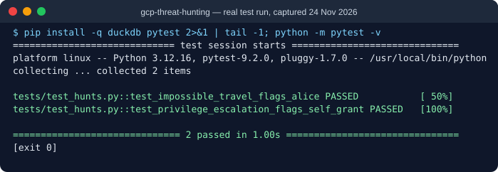

# GCP Threat-Hunting pipeline — manual

*One page, eight blocks. Every figure here comes from this repository's own tests and README.*

## 1. Claim
Two hunts written in portable SQL (impossible travel; self-granted Owner/Editor) catch the planted threats in seeded audit logs and do not flag the benign activity.

## 2. What it is
Threat hunts written as SQL queries that can be reviewed, versioned and tested. They run on BigQuery in production and on DuckDB in CI.

## 3. Demo
Capture to record: the DuckDB-backed test run showing both planted threats found.


*Real output from this repository's own tests, captured 24 Nov 2026.*

## 4. Run it yourself
**Prerequisites:** Python 3 with duckdb. A GCP project only for the BigQuery deploy.

```bash
pip install duckdb pytest
pytest -q
```

## 5. What you will see
2 tests pass. The London-to-Sydney-in-12-minutes login and the self-granted Owner are flagged; benign activity is not.

## 6. 30-second talking point
> "We should look for X" usually ends as a one-off console search. Here a hunt is a tested query, and the tests include benign look-alikes, so a hunt that over-fires fails too.

## 7. Scope and limits
- A starter set of hunts. Coverage grows with the environment's threat model.

## 8. Links
[Repository](https://github.com/fhionnghaile/gcp-threat-hunting) · [Write-up](https://padraigfhionnghaile.com/work/gcp-threat-hunting/) · [README](README.md)
